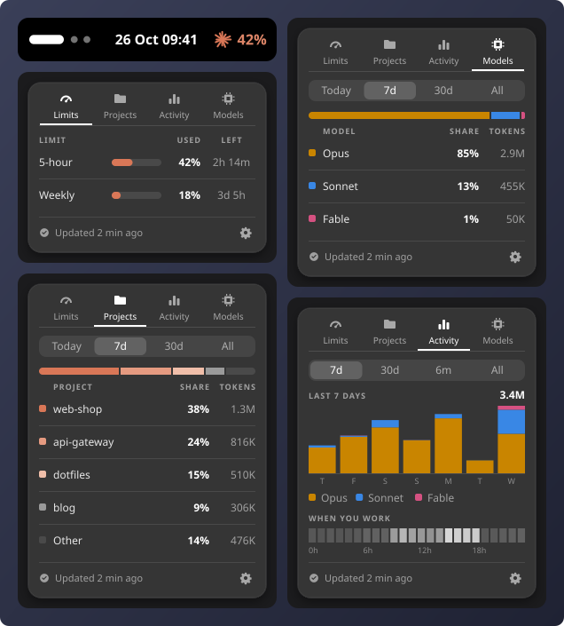

# Claudometer

Your Claude Code plan limits in the GNOME top bar, and how you use Claude Code over time.

<p align="center">
  <a href="#claudometer"></a>
</p>

## Install

Needs GNOME Shell 46 to 51 and Claude Code signed in with a Pro or Max plan.

**From extensions.gnome.org:** coming soon.

**With one command:**

```bash
curl -fsSL https://raw.githubusercontent.com/emanuel36/claudometer/main/install.sh | sh
```

Then log out and back in. On an X11 session you can instead press Alt+F2, type `r` and press
Enter.

Use the gear at the bottom of the popup to change the top bar's look, the tabs shown, the
periods and how often the limits refresh.

To update, run the same command again and log out and back in.

## Privacy

Your Claude Code login is only sent to Anthropic, to read your limits. Your history never
leaves the computer, and the conversations themselves are never read.

[MIT](LICENSE) · Not affiliated with or endorsed by Anthropic.
