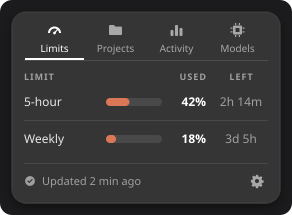
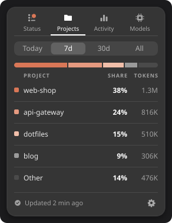
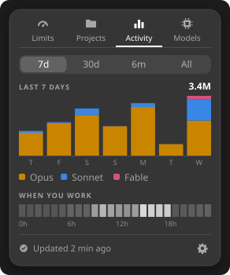
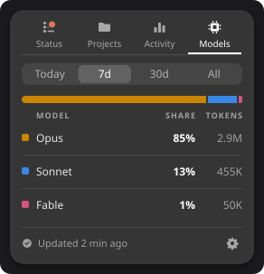

# Claudometer

Your Claude Code plan limits in the GNOME top bar, and how you use Claude Code over time.

<table>
  <tr>
    <td align="center" valign="top"><br><b>Limits</b><br>Time left to each reset</td>
    <td align="center" valign="top"><br><b>Projects</b><br>Where your tokens go</td>
    <td align="center" valign="top"><br><b>Activity</b><br>Per day, and when you work</td>
    <td align="center" valign="top"><br><b>Models</b><br>Each model's share</td>
  </tr>
</table>

## Install

Needs GNOME Shell 46 and Claude Code signed in with a Pro or Max plan.

**From extensions.gnome.org:** coming soon.

**Manually:**

1. Download it and link it into your extensions folder:
   ```bash
   git clone https://github.com/emanuel36/claudometer.git
   ln -s "$PWD/claudometer" ~/.local/share/gnome-shell/extensions/claudometer@emanuel36
   glib-compile-schemas claudometer/schemas
   ```
2. Restart GNOME Shell: on X11, press Alt+F2, type `r` and press Enter; on Wayland, log out
   and back in.
3. Turn it on in the Extensions app, or run `gnome-extensions enable claudometer@emanuel36`.

Then use the gear at the bottom of the popup to change the top bar's look, the tabs shown, the
periods and how often the limits refresh.

To update, run `git pull` and `glib-compile-schemas schemas` in the `claudometer` folder, then
restart GNOME Shell.

## Privacy

Your Claude Code login is only sent to Anthropic, to read your limits. Your history never
leaves the computer, and the conversations themselves are never read.

[MIT](LICENSE) · Not affiliated with or endorsed by Anthropic.
