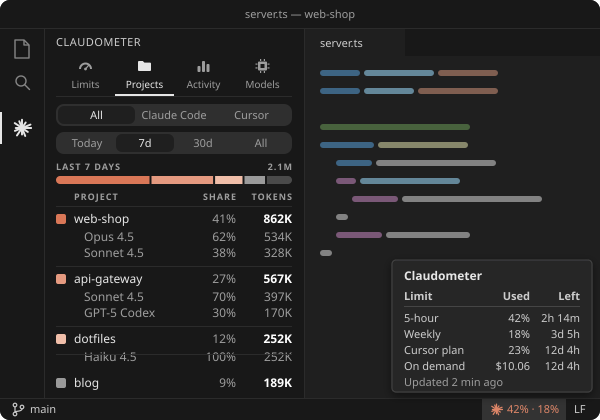

# Claudometer

Your Claude Code plan limits in the GNOME top bar, in VS Code and Cursor, or in the terminal on
Windows, macOS and Linux, and how you use Claude Code and Cursor over time.

<p align="center">
  <a href="#claudometer"></a>
</p>

<p align="center"><br><b>VS Code and Cursor</b><br>The same tabs, with the models used in each project</p>

Every way below needs Claude Code signed in with a Pro or Max plan for the limits. The history
comes from Claude Code, whether it runs in the terminal or in an editor.

## GNOME

Needs GNOME Shell 46.

**From extensions.gnome.org:** coming soon.

**With one command:**

```bash
curl -fsSL https://raw.githubusercontent.com/emanuel36/claudometer/main/install.sh | sh
```

Then restart GNOME Shell: on X11, press Alt+F2, type `r` and press Enter; on Wayland, log out
and back in.

Use the gear at the bottom of the popup to change the top bar's look, the tabs shown, the
periods and how often the limits refresh.

To update, run the same command again and restart GNOME Shell.

## VS Code, Cursor and other editors

Works in VS Code, Cursor, Windsurf and VSCodium, on Windows, macOS and Linux. The limits sit in
the status bar; click them, or the spark in the activity bar, for the tabs. In Projects, click
a project to see the tokens of each model it used.

**From the Marketplace and Open VSX:** coming soon.

**Manually**, with [Node.js](https://nodejs.org) 18.17 or later:

```bash
git clone https://github.com/emanuel36/claudometer.git
cd claudometer/packages
npm ci
npm run package
code --install-extension vscode/claudometer.vsix
```

In Cursor, use `cursor` instead of `code`. Search for "Claudometer" in the settings, or use the
gear in the panel, to change what it shows.

## Terminal and Claude Code's status line

For Windows, macOS and Linux, when you use Claude Code or Cursor only in the terminal or in an
agent tab. Needs [Node.js](https://nodejs.org) 18.17 or later.

```bash
git clone https://github.com/emanuel36/claudometer.git
cd claudometer/packages
npm ci
npm run build
npm install -g ./cli
```

Then `claudometer` shows your limits, and `claudometer projects`, `claudometer models` and
`claudometer activity` show where your tokens go; `claudometer --help` lists the rest.

To see your limits under Claude Code's prompt, like `✻ 5h 42% 2h 13m · wk 18% · today 1.2M`,
run `claudometer install-statusline` and restart Claude Code. `claudometer uninstall-statusline`
removes it.

## Cursor usage

Cursor's usage is off until you turn it on. Once on, every model Cursor ran, not only Claude,
joins the history, split by project and by model, and your Cursor plan joins the limits. In the
terminal it needs Node.js 22.13 or later; Cursor itself already has what it needs.

- **In Cursor:** answer the question Claudometer asks the first time, or run **Claudometer: Add
  Cursor Usage (All Models)**.
- **In the terminal:** run `claudometer cursor on`.

Agent chats in the editor land in their project by themselves. Chats of the Cursor CLI do once
you run **Claudometer: Note the Projects of Cursor CLI Chats**, or `claudometer cursor hook on`.

## Privacy

Your Claude Code login is only sent to Anthropic, to read your limits. With Cursor's usage on,
Cursor's login is only sent to cursor.com, to read your usage. Your history never leaves the
computer, and the conversations themselves are never read.

[MIT](LICENSE) · Not affiliated with or endorsed by Anthropic or Anysphere.
